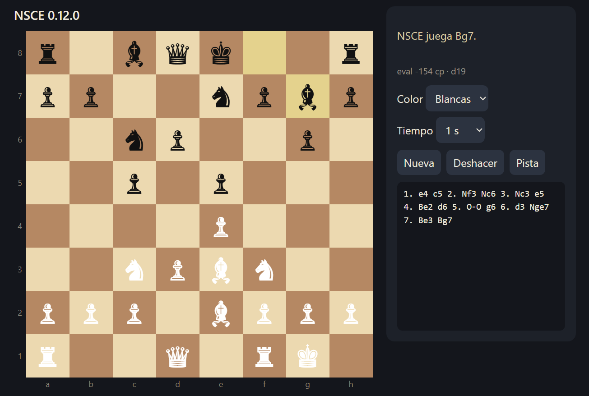
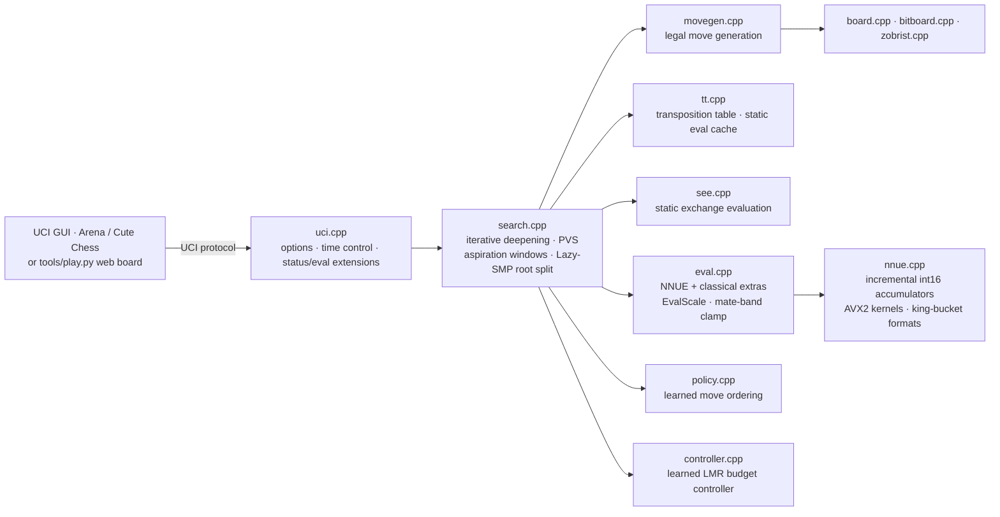
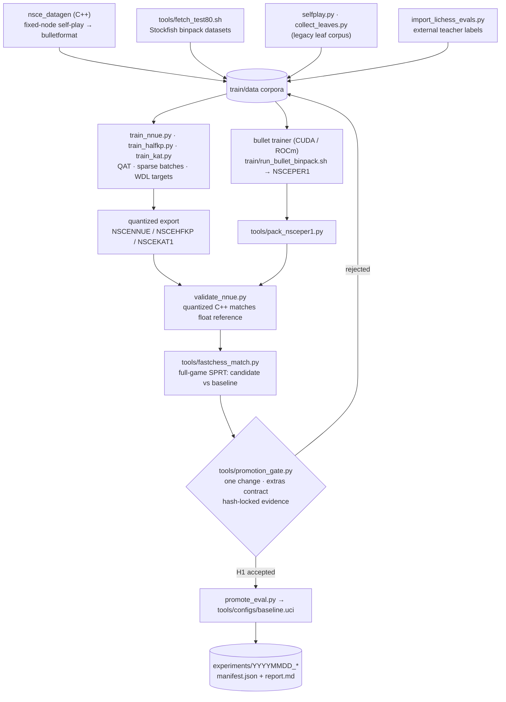

<div align="center">

# ♞ Optiline — NSCE Chess Engine

**A UCI chess engine pairing a modern alpha–beta searcher with quantized NNUE evaluation — shipped alongside the fully gated, evidence-driven training pipeline that builds its networks.**

[](https://github.com/gonzalocolina/Optiline/actions/workflows/ci.yml)
[](https://github.com/gonzalocolina/Optiline/actions/workflows/release.yml)
[](https://github.com/gonzalocolina/Optiline/releases/latest)
[](CMakeLists.txt)
[](CMakeLists.txt)
[](CMakeLists.txt)
[](train)
[](experiments/20261114_simple1024_test80_elo/report.md)
[](LICENSE)

</div>

---

## At a Glance

<p align="center">
  
</p>

- **What it is:** A high-performance chess engine written in C++20 (bitboards, PVS search, SIMD NNUE evaluation with AVX2 kernels), coupled with a complete Python and GPU/bullet pipeline that generates self-play data, trains, quantizes, and promotes neural networks.
- **Strength:** **~3100 ± 35 Elo** on Stockfish 18's `UCI_Elo` scale at 100 ms/move. Outscores Stockfish limited to Elo 2900 by **+125 ± 43 Elo** ([evidence dossier](experiments/20261114_simple1024_test80_elo/report.md)).
- **Validation:** 94 GoogleTest unit test cases, 170+ Python contract and pipeline tests, a 4-target CI matrix with ASan/UBSan/TSan sanitizers, and rigorous full-game SPRT matches before any network or parameter change is promoted. 110+ reproducible experiment reports live under [`experiments/`](experiments).
- **Naming convention:** *Optiline* is the project and repository; the engine binary built from source identifies itself over the UCI protocol as **NSCE**.

**Try it in one minute:** Download `nsce-0.12.0-windows-x86_64.zip` or the Linux AVX2 tarball from the [latest release](https://github.com/gonzalocolina/Optiline/releases/latest) and load `nsce` in any UCI GUI (Arena, Cute Chess, En Croissant). To play in the browser board shown above, build from source and run `./play.sh` (see [Play Against the Engine](#play-against-the-engine)).

---

## Table of Contents

- [At a Glance](#at-a-glance)
- [Overview](#overview)
- [Why This Project Stands Out](#why-this-project-stands-out)
- [System Architecture](#system-architecture)
  - [Engine Core](#engine-core)
  - [Training & Promotion Loop](#training--promotion-loop)
  - [Design Trade-offs](#design-trade-offs)
- [Directory Structure](#directory-structure)
- [Prerequisites & Installation](#prerequisites--installation)
- [Configuration & Usage](#configuration--usage)
  - [Play Against the Engine](#play-against-the-engine)
  - [UCI Session](#uci-session)
  - [UCI Options](#uci-options)
  - [Benchmarks & Datagen](#benchmarks--datagen)
  - [Training a Network](#training-a-network)
  - [Gating & Promotion](#gating--promotion)
- [Testing & Validation](#testing--validation)
- [GitHub Releases](#github-releases)
- [Results & Metrics](#results--metrics)
- [License & Author](#license--author)

---

## Overview

**NSCE** is a complete, modern chess engine. For every position, it builds a search tree of legal continuations, aggressively prunes hopeless branches using alpha–beta pruning with an extensive suite of modern heuristics, and evaluates leaf positions with a quantized neural network (NNUE) rather than hand-crafted point values. The neural network evaluates the position; the search tree decides the move.

The repository contains two tightly integrated halves:

| Subsystem | Scope | Technologies |
| --- | --- | --- |
| [`engine/`](engine) | The playing engine: bitboards, move generation, PVS search, NNUE inference, UCI protocol, self-play datagen | C++20, CMake, AVX2 + FMA kernels |
| [`train/`](train) + [`tools/`](tools) | The training and validation pipeline: data generation, model training, quantization, SPRT gating, and promotion | Python (stdlib + NumPy), bullet trainer (CUDA / ROCm), fastchess |

The engine is engineered specifically for **constrained consumer hardware** (laptops and desktop CPUs) rather than unlimited compute clusters. The north star is pinned Stockfish builds at identical time per move. Every strength claim in this repository is backed by an immutable, reproducible experiment artifact under [`experiments/`](experiments).

### Release Status & Development Branch

- **Current Published Release: [v0.12.0](https://github.com/gonzalocolina/Optiline/releases/tag/v0.12.0)** (~3100 ± 35 Elo on Stockfish 18's `UCI_Elo` scale at 100 ms/move; see [evidence](experiments/20261114_simple1024_test80_elo/report.md) and [`tools/release_strength.json`](tools/release_strength.json)). It bundles precompiled Linux AVX2 and Windows binaries with the `nsceper1_simple1024_test80` network.
- **Current Development Tree: v0.13-dev** (`project(nsce VERSION 0.13.0)` in [`CMakeLists.txt`](CMakeLists.txt)). Beyond v0.12.0, this branch integrates an SPSA tuning round conducted directly on the promoted `simple1024` network ([`experiments/20261114_spsa_simple1024/`](experiments/20261114_spsa_simple1024/report.md), adding **+13.9 ± 5.7 Elo** at 50k nodes and **+7.0 ± 3.7 Elo** at 100 ms), quiet history indexed by threats, and static evaluation caching in the transposition table.
- **Current Promoted Baseline** ([`tools/configs/baseline.uci`](tools/configs/baseline.uci)): The `nsceper1_simple1024_test80` network — a dual-perspective (768→1024)×2 squared SCReLU topology feeding 8 material output buckets, trained on 8.0 G public Stockfish binpack positions (`linrock/test80-2024`). Classical extras are disabled (`UseExtras false`) for this network, letting the neural evaluator guide the search unperturbed.

---

## Why This Project Stands Out

- **Full-Stack Ownership:** A single cohesive codebase covers the entire lifecycle: bitboard move generation → iterative deepening PVS search → int16 AVX2 NNUE inference → self-play bulletformat data generation → NumPy/bullet training → quantized export → full-game SPRT gating → automated promotion.
- **Evidence-Driven Promotion, Not Vibes:** Networks and search parameters are never promoted on validation loss or short test games. Promotion requires an accepted full-game fastchess SPRT match against the active baseline, an extras contract check, and hash-locked artifacts verified by [`tools/promotion_gate.py`](tools/promotion_gate.py).
- **Rigorous Measurement Culture:** 110+ dated experiment dossiers under [`experiments/`](experiments), each containing an immutable `manifest.json` (engine SHA-256, opening book hash, seed, concurrency) and a detailed `report.md`. Reference Stockfish binaries (SF17, SF18, SF19, dev) are pinned by cryptographic hash via [`tools/freeze_targets.py`](tools/freeze_targets.py).
- **Honest Scope & Transparency:** The engine's ceiling is published openly, including matches against unlimited-strength Stockfish that it cannot yet win.
- **Defense in Depth:** 94 GoogleTest unit test cases, 170+ Python contract tests, UCI smoke matches, benchmark regression tests, and a 4-configuration CI matrix (Release, ASan+UBSan, TSan, and Telemetry Stats).

---

## System Architecture

### Engine Core



**Search** ([`engine/src/search.cpp`](engine/src/search.cpp)) implements the modern pruning canon, with every heuristic individually toggleable via UCI for ablation studies:

- **PVS Framework:** Principal Variation Search with aspiration windows, iterative deepening, and soft/hard time management with `MoveOverhead` compensation.
- **Transposition Table:** Clustered replacement scheme with raw-eval substitution, static evaluation caching, and multi-table correction history (pawn, non-pawn, and continuation tables).
- **Selectivity & Reductions:** Late Move Reductions (separate quiet and capture tables, dynamically retuned via SPSA), Late Move Pruning (LMP), reverse futility pruning (RFP), razoring, and futility pruning.
- **Extensions & Pruning:** Null-move pruning with verification search, ProbCut, SEE-based pruning, singular extensions (including double extensions), and Internal Iterative Reductions (IIR).
- **Move Ordering:** Transposition table move, winning/equal captures ordered via SEE, killer moves, threat-indexed quiet history (`main_history` indexed by attacked squares), capture history, continuation history across two plies (`ss-1`, `ss-2`), and countermoves.
- **Parallel Search & Telemetry:** Lazy-SMP parallel root splitting across a worker pool (`Threads`, 1–64); pondering support; low-overhead atomic search counters under `-DNSCE_STATS=ON`.

**Evaluation** ([`engine/src/eval.cpp`](engine/src/eval.cpp), [`engine/src/nnue.cpp`](engine/src/nnue.cpp)) is NNUE-centric with optional classical *extras* (`UseExtras`), strictly clamped outside the mate band. The runtime supports four neural architectures:

| Format | Topology | Characteristics |
| --- | --- | --- |
| `NSCENNUE` | 768 → 128 → 1, int16 | Classic single-perspective accumulator; export contract baseline (~2400 Elo). |
| `NSCEHFKP` | 16 king buckets × 768 | HalfKA-lite architecture with dual accumulators. |
| `NSCEKAT1` | 32 mirrored king buckets × 768 + 12-dim threat residual | King-relative HalfKA-hm research path. |
| `NSCEPER1` | Dual-perspective bullet networks: **Simple** ((768→N)×2 squared SCReLU → optional 8 material buckets, N ≤ 1024), **HL** ((768→512)×2 → 32 → 1), or **MLP** | **Promoted baseline format** (`simple1024`, 8 material buckets, ~3100 Elo). Evaluated using high-throughput 16-bit AVX2 kernels without int64 promotion. |

Two auxiliary learned models integrate directly into the searcher: a compact **policy network** ([`policy.cpp`](engine/src/policy.cpp)) for move ordering, and a linear **search controller** ([`controller.cpp`](engine/src/controller.cpp)) fitted from LMR telemetry to adjust reduction budgets dynamically.

### Training & Promotion Loop



### Design Trade-offs

- **Int16 Quantization Everywhere:** Incremental AVX2 accumulators trade minor centipawn precision for massive throughput gains on consumer CPUs. For `simple1024` nets, weights are clipped so that activation products fit squarely into int16, executing squared SCReLU in a single fused instruction.
- **Frozen Topology under Contract:** The foundational 768×128×1 network serves as an export contract: the quantized C++ forward pass must reproduce frozen reference outputs through [`train/validate_nnue.py`](train/validate_nnue.py) before any candidate enters an Elo gate.
- **Full Games Over Truncated Probes:** Legacy 60-ply matches frequently decayed into artificial draws. All gating and evaluation matches use full-game fastchess with strict two-sided adjudication rules.
- **Deterministic Evidence:** Every experiment logs the exact engine commit hash, opening book hash, random seed, and hardware concurrency. Reference binaries (Stockfish) are pinned by cryptographic hash rather than bundled in the repository.
- **CPU-First Portability with GPU Acceleration:** Building, playing, running tests, and executing the NumPy trainer require only a standard C++20 compiler and Python. GPU acceleration is leveraged on the bullet training path, supporting both NVIDIA (CUDA) and AMD (ROCm).

---

## Directory Structure

```text
optiline/
├── CMakeLists.txt              # Build configuration: engine library, UCI binary, tests, benches, datagen
├── play.sh                     # One-shot launcher: builds (if needed) and serves the local web board
├── LICENSE                     # GNU General Public License v3
│
├── engine/                     # ── C++20 Engine Core ─────────────────────────
│   ├── include/nsce/           # Public headers (search, nnue, tt, board, movegen, tune, …)
│   ├── src/                    # Engine implementation (search, eval, nnue, bitboard, uci, datagen, …)
│   ├── tests/                  # GoogleTest suites (perft, board, nnue, search, see, tt, datagen)
│   └── benches/                # Benchmarks: bench_search, bench_nnue_latency, bench_components, datagen_main
│
├── train/                      # ── Training Pipeline ─────────────────────────
│   ├── run_bullet_binpack.sh   # Bullet GPU trainer for bucketed NSCEPER1 nets (production path)
│   ├── bullet_nsce_simple_binpack.rs # Rust bullet graph for (768→N)×2 SCReLU → 8 buckets
│   ├── train_nnue.py           # Quantization-aware CPU trainer for 768×128×1 (export reference)
│   ├── train_halfkp.py         # 16-bucket king-relative trainer (NSCEHFKP)
│   ├── train_kat.py            # 32 mirrored king buckets + threat residual (NSCEKAT1)
│   ├── validate_nnue.py        # Export gate: verifies quantized C++ matches floating-point reference
│   ├── distill.py / import_lichess_evals.py # Teacher distillation and Lichess dataset importers
│   └── tests/                  # Unittest suite for the training pipeline (55 tests)
│
├── tools/                      # ── Experiment & Tuning Infrastructure ────────
│   ├── fastchess_match.py      # Concurrent full-game match runner, SPRT, and Elo estimation
│   ├── promotion_gate.py       # Gatekeeper: enforces single-variable change & evidence verification
│   ├── promote_eval.py         # Promotes an accepted candidate into tools/configs/baseline.uci
│   ├── spsa_nodes.py           # SPSA parameter tuner (fixed-node or fixed-time paired games)
│   ├── fetch_test80.sh         # Downloader & SHA-256 verifier for public Stockfish binpack datasets
│   ├── pack_nsceper1.py        # Quantizes and packs bullet checkpoints into NSCEPER1 binaries
│   ├── freeze_targets.py       # Pins engine and reference Stockfish binaries by SHA-256
│   ├── play.py / play.sh       # Local web board server (127.0.0.1:8765) and interactive ASCII CLI
│   ├── configs/                # Pinned UCI configuration profiles (baseline.uci, baseline_768.uci, …)
│   ├── openings*.epd           # Balanced and UHO opening books for SPRT and ladder matches
│   └── tests/                  # Contract tests for match runners and release tooling (119 tests)
│
├── nets/                       # Promoted quantized network binaries and metric JSONs
├── experiments/                # 110+ dated experiment dossiers: manifest.json + report.md
├── third_party/stockfish/      # Pinned reference binaries (gitignored, cryptographically locked)
└── .github/workflows/          # ci.yml (4-build matrix) and release.yml (automated GitHub Releases)
```

---

## Prerequisites & Installation

| Requirement | Supported Version | Purpose |
| --- | --- | --- |
| CMake | ≥ 3.16 | Build system generator |
| C++ Compiler | GCC or Clang with C++20 support | Engine core (`-std=c++20`, `-O3`, LTO, `-march=native`) |
| Python | ≥ 3.10 (+ `numpy`) | Training pipeline, match orchestration, and local web board |
| Make / Ninja | Any modern version | Build execution |
| *(Optional)* Rust + CUDA / ROCm | CUDA 12.2 or ROCm/HIP | GPU-accelerated bullet training for `NSCEPER1` nets ([`tools/setup_bullet.sh`](tools/setup_bullet.sh); NVIDIA: [`tools/setup_cuda_local.sh`](tools/setup_cuda_local.sh); AMD: Debian `hipcc libhipblas-dev librocblas-dev rocminfo`, user in the `render` group, [`tools/rocm_env.sh`](tools/rocm_env.sh)) |
| *(Optional)* MinGW-w64 | llvm-mingw | Cross-compiling portable Windows AVX2+BMI2 binaries via [`cmake/mingw-w64-x86_64.cmake`](cmake/mingw-w64-x86_64.cmake) |

### Building from Source

Build the optimized release binary with native CPU instructions, AVX2 NNUE kernels, and Link-Time Optimization (LTO):

```bash
cmake -S . -B build -DCMAKE_BUILD_TYPE=Release
cmake --build build -j"$(nproc)"
```

The build produces the following executables in `build/`:
- `build/nsce`: The main UCI chess engine.
- `build/nsce_tests`: GoogleTest executable (94 test cases).
- `build/nsce_bench`, `build/nsce_bench_nnue`, `build/nsce_bench_components`: Performance benchmarks.
- `build/nsce_datagen`: High-throughput self-play data generator in bulletformat.

### CMake Configuration Switches

| Option | Default | Description |
| --- | --- | --- |
| `NSCE_NATIVE` | `ON` | Optimizes instructions for the host CPU (`-march=native`). |
| `NSCE_AVX2` | `ON` | Compiles specialized AVX2 + FMA SIMD kernels for NNUE inference. |
| `NSCE_LTO` | `ON` | Enables interprocedural / Link-Time Optimization (IPO/LTO). |
| `NSCE_SANITIZE` | `OFF` | Enables AddressSanitizer (ASan) and UndefinedBehaviorSanitizer (UBSan). |
| `NSCE_TSAN` | `OFF` | Enables ThreadSanitizer (TSan) for data-race verification. |
| `NSCE_STATS` | `OFF` | Compiles low-overhead search counters for profiling and telemetry. |
| `NSCE_TUNE` | `OFF` | Exposes internal search constants as adjustable UCI spin options for live SPSA tuning. |
| `NSCE_PGO_GENERATE` / `NSCE_PGO_USE` | `OFF` | Two-pass Profile-Guided Optimization (PGO). |

---

## Configuration & Usage

### Play Against the Engine

Launch a local web interface to play against the engine in your browser:

```bash
./play.sh            # Serves the local board at http://127.0.0.1:8765/
./play.sh --cli      # Launches an interactive ASCII board in your terminal
```

`play.sh` verifies that `build/nsce` is built (compiling it automatically if missing) and launches [`tools/play.py`](tools/play.py) with the promoted baseline configuration ([`tools/configs/baseline.uci`](tools/configs/baseline.uci)).

To play in external GUIs (e.g. Arena, Cute Chess, En Croissant, Banksia), add `build/nsce` as a standard UCI engine.

### UCI Session

```text
$ ./build/nsce
uci
id name NSCE 0.13.0
id author Gonzalo
option name Hash type spin default 16 min 1 max 4096
option name Clear Hash type button
option name Threads type spin default 1 min 1 max 64
option name MoveOverhead type spin default 10 min 0 max 5000
option name UseNNUE type check default true
...
uciok
setoption name Threads value 4
setoption name Hash value 64
setoption name EvalFile value nets/nsceper1_simple1024_test80.bin
setoption name UseExtras value false
isready
readyok
position startpos moves e2e4 c7c5
go depth 14
...
info depth 14 seldepth 24 score cp 77 nodes 99544 nps 4524727 hashfull 8 time 22 pv g1f3 d7d6 b1c3 e7e5 ...
bestmove g1f3
```

Beyond the standard protocol, NSCE provides built-in diagnostic and inspection commands:
- `bench [depth]`: Fixed-work search benchmark measuring speed (NPS) and node reproducibility.
- `perft [depth]`: Move generation correctness and node count verification.
- `d`: Prints the FEN of the current position.
- `status`: Adjudication oracle (`checkmate`, `stalemate`, `draw`, or `ongoing`).
- `legalmoves`: Lists every legal move in the current position.
- `eval` / `eval details`: Static evaluation; `details` adds the NNUE score, applied classical extras and the simple material eval.
- `hashfull`: Current transposition table occupancy in per-mille.

### UCI Options

| Option | Type | Default | Valid Range / Values | Description |
| --- | --- | --- | --- | --- |
| `Hash` | spin | 16 | 1–4096 MB | Transposition table size in megabytes. |
| `Clear Hash` | button | — | — | Clears all entries in the transposition table. |
| `Threads` | spin | 1 | 1–64 | Number of helper search threads (Lazy-SMP). |
| `MoveOverhead` | spin | 10 | 0–5000 ms | Safety time margin deducted from the clock to absorb GUI/network lag. |
| `UseNNUE` | check | true | true / false | Enables neural network evaluation (falls back to classical HCE if false). |
| `EvalFile` | string | `nets/nnue_trained.bin` | file path or `internal` | Path to the NNUE weight binary (`internal` loads PST-distilled weights). |
| `UseExtras` | check | true (engine default)<br/>**false** in `baseline.uci` | true / false | Adds classical evaluation terms to NNUE. *(Disabled for promoted PER1 nets).* |
| `EvalScale` | spin | 1000 | 250–4000 | Per-mille evaluation multiplier applied to final centipawn scores. |
| `UsePolicy` | check | false | true / false | Enables learned policy-based move ordering (`PolicyFile`). |
| `PolicyFile` | string | `<internal>` | file path | Path to policy network weights. |
| `UseSearchController` | check | false | true / false | Enables the dynamic LMR reduction controller (`ControllerFile`). |
| `ControllerFile` | string | `<internal>` | file path | Path to search controller weights. |
| `UseTT` · `UseSEE` · `UseLMR` · `UseNullMove` · `UseFutility` · `UseLMP` · `UseRazoring` · `UseRFP` · `UseProbCut` | check | true | true / false | Independent ablation switches for every search pruning and reduction heuristic. |
| `TelemetryFile` / `LeafTelemetryFile` | string | `<empty>` | file path | Destination files for structured search telemetry and leaf evaluation logs. |

> [!NOTE]
> When built with `-DNSCE_TUNE=ON`, over 40 internal search constants (reduction formulas, pruning margins, history bonuses) are automatically exposed as additional UCI spin options for live SPSA tuning.

### Benchmarks & Datagen

```bash
# Search and movegen performance benchmarks
./build/nsce bench 8                     # Fixed-work search benchmark (also: python3 tools/bench.py)
./build/nsce perft 6                     # Legal move generation throughput
./build/nsce_bench 8 1 1 internal        # Standalone search harness
./build/nsce_bench_nnue 100000 internal  # Pure NNUE inference latency (100k positions)
./build/nsce_bench_components 1000 internal # Subsystem microbenchmarks

# High-throughput self-play data generation (bulletformat, multi-threaded, adjudicated)
# Request 1.25e6 games, not 1.2e6: run_bullet.sh requires 1e8 positions in the training
# file after a whole-game holdout, and a 5% holdout of 1.2e6 games can fall short.
./build/nsce_datagen --out train/data/gen0.bin --games 1250000 --nodes 5000 \
  --threads "$(nproc)" --eval-file nets/nsceper1_simple1024_test80.bin --seed 1
```

### Training a Network

The repository supports two training paradigms: the production GPU-accelerated bullet pipeline (the path responsible for the ~3100 Elo networks), and the CPU-based NumPy reference pipeline.

#### 1. Production Pipeline: Bullet on Public Stockfish Binpacks (GPU / Elo Path)

```bash
# 1. Download and verify public Stockfish binpack datasets (linrock/test80-2024, ~42 GB)
bash tools/fetch_test80.sh

# 2. Build the bullet trainer, train the bucketed simple1024 network (CUDA or ROCm),
#    pack it with tools/pack_nsceper1.py and check the quantized export
NSCE_GRAPH=simple NSCE_FT=1024 NSCE_SUPERBATCHES=80 bash train/run_bullet_binpack.sh
```

The script writes `nets/nsceper1_<run>.bin`, candidate UCI configs under `train/candidates/` and a manifest under `experiments/`; it does not play games or promote, so screen the packed net with `tools/fastchess_match.py` afterwards.

#### 2. Export Reference: Quantization-Aware Training (NumPy / CPU)

```bash
python3 -m venv .venv
.venv/bin/python -m pip install numpy

# Quantization-aware training of the frozen 768×128×1 reference topology
.venv/bin/python train/train_nnue.py \
  --data train/data/nsce_static_games.jsonl \
  --epochs 80 --seed 20260802 --target-mode wdl \
  --teacher-wdl-scale 400 --search-wdl-scale 400 \
  --result-weight 0.20 --residualize-extras --init internal

# Export validation gate: confirms the C++ forward pass precisely reproduces Python scores
.venv/bin/python train/validate_nnue.py \
  --engine build/nsce --data train/data/nsce_static_games.jsonl \
  --network nets/nnue_trained.bin --use-extras --gate clone
```

Full details on HalfKP/KAT architectures, ROCm environment configuration for AMD GPUs, and distillation pipelines are available in [`train/README.md`](train/README.md).

### Gating & Promotion

Before any candidate network or parameter set is promoted, it must pass a rigorous, full-game fastchess SPRT match:

```bash
# Candidate vs Baseline SPRT (fastchess tests whether engine A is stronger than engine B)
# H0 / H1 = [0.0, 5.0] nElo, time control 8s + 0.08s increment
python3 tools/fastchess_match.py \
  --cfg-a tools/configs/candidate.uci \
  --cfg-b tools/configs/baseline.uci \
  --tc 8+0.08 --sprt 0 5 --rounds 3000 \
  --outdir experiments/$(date +%Y%m%d)_candidate_sprt
```

Only when fastchess accepts **H1** (proving the candidate statistically superior with $\alpha=\beta=0.05$), satisfies the single-variable modification rule, and passes all contract checks in [`tools/promotion_gate.py`](tools/promotion_gate.py), can [`tools/promote_eval.py`](tools/promote_eval.py) update [`tools/configs/baseline.uci`](tools/configs/baseline.uci).

---

## Testing & Validation

Run the complete test suite locally:

```bash
cmake -S . -B build -DCMAKE_BUILD_TYPE=Release
cmake --build build -j"$(nproc)"
ctest --test-dir build --output-on-failure
```

| Test Target | Scope | What It Validates |
| --- | --- | --- |
| `nsce_tests` | GoogleTest (94 test cases) | Move generation (perft startpos & Kiwipete); FEN round-tripping; evasion legality; incremental NNUE accumulators vs. full refresh across moves and undos for **all four network formats**; mate-in-N search; Lazy-SMP mate preservation; TT clustering and static eval caching; SEE correctness; and thread-independent datagen determinism. |
| `PythonExperimentTests` | `tools/tests/` (119 test cases) | Match runner contracts, SPRT parsing, release packaging, and gating mechanics. |
| `PythonTrainTests` | `train/tests/` (55 test cases) | Data generation formats, bullet parsing, trainer math, and export contracts. |
| `UciSmoke` | Integration | End-to-end full game execution over the standard UCI protocol. |
| `SearchBenchSmoke`<br/>`NnueBenchSmoke`<br/>`ComponentsBenchSmoke` | Microbenchmarks | Sanity checks ensuring all benchmark harnesses build and run cleanly. |

### Sanitizers and CI Matrix

Automated CI ([`.github/workflows/ci.yml`](.github/workflows/ci.yml)) tests every commit across four separate configurations:

```bash
# AddressSanitizer + UndefinedBehaviorSanitizer
cmake -S . -B build-asan -DCMAKE_BUILD_TYPE=RelWithDebInfo -DNSCE_SANITIZE=ON -DNSCE_LTO=OFF
cmake --build build-asan -j"$(nproc)" && ctest --test-dir build-asan --output-on-failure

# ThreadSanitizer (data races)
cmake -S . -B build-tsan -DCMAKE_BUILD_TYPE=RelWithDebInfo -DNSCE_TSAN=ON -DNSCE_LTO=OFF
cmake --build build-tsan -j"$(nproc)" && ctest --test-dir build-tsan --output-on-failure
```

Every CI run finishes with a multithreaded UCI search stress test (`Threads=4, depth 8`).

---

## GitHub Releases

The latest published release is **[NSCE 0.12.0](https://github.com/gonzalocolina/Optiline/releases/tag/v0.12.0)** (`nsce-0.12.0-linux-x86_64-avx2.tar.gz`, `nsce-0.12.0-windows-x86_64.zip`, and `SHA256SUMS`), rated at **~3100 ± 35 Elo** on the Stockfish 18 `UCI_Elo` scale.

The release workflow is automated via [`.github/workflows/release.yml`](.github/workflows/release.yml):
1. `project(nsce VERSION X.Y.Z)` in [`CMakeLists.txt`](CMakeLists.txt) is the single source of truth for the engine's identity string.
2. Pushing a matching git tag (`v0.13.0`) triggers cross-compilation of portable Linux AVX2 and Windows binaries, runs unit tests, verifies the UCI banner, and publishes release artifacts accompanied by measured strength metrics from [`tools/release_strength.json`](tools/release_strength.json).

To generate release archives locally:

```bash
python3 tools/package_release.py pack \
  --binary build/nsce --platform linux-x86_64-avx2 --outdir dist
```

---

## Results & Metrics

### Strength Ladder vs. Pinned Stockfish 18

Matches played at **100 ms/move** with 1 search thread, `Hash 16`, full games with paired colors from [`tools/openings_balanced.epd`](tools/openings_balanced.epd), using fastchess with two-sided adjudication:

| NSCE Network / Config | Opponent | Games | W–D–L (NSCE) | Score | Measured Elo ± 95% | Evidence Dossier |
| --- | --- | ---: | ---: | ---: | ---: | --- |
| **`nsceper1_simple1024_test80`** | Stockfish 18 `UCI_Elo=2600` | 200 | 192–4–4 | 97.0% | **+604 ± 156** | [report](experiments/20261114_simple1024_test80_elo/report.md) |
| **`nsceper1_simple1024_test80`** | Stockfish 18 `UCI_Elo=2900` | 200 | 109–51–40 | 67.2% | **+125 ± 43** | [report](experiments/20261114_simple1024_test80_elo/report.md) |
| **`nsceper1_simple1024_test80`** | Stockfish 18 `UCI_Elo=3190` (max rung) | 200 | 52–73–75 | 44.2% | **−40 ± 37** | [report](experiments/20261114_simple1024_test80_elo/report.md) |
| **`nsceper1_simple1024_test80`** | Stockfish 18 Unlimited | 100 | 1–25–74 | 13.5% | **−323 ± 64** | [report](experiments/20261114_simple1024_test80_elo/report.md) |
| Previous 768×128 baseline (`baseline_768.uci`) | Stockfish 18 `UCI_Elo=2200` | 200 | 152–3–45 | 76.8% | **+208 ± 54** | [report](experiments/20261114_simple1024_test80_elo/report.md) |
| Previous 768×128 baseline | Stockfish 18 Unlimited | 100 | 0–1–99 | 0.5% | Out of reach | [report](experiments/20260915_sf18_unlimited_100ms/report.md) |

> [!NOTE]
> `UCI_Elo` is an internal Stockfish calibration scale at rapid time controls, not an absolute FIDE or CCRL rating. It provides a reproducible, pinned benchmark ladder for comparative evaluation.

### Promoted Network Artifact

- **Network File:** [`nets/nsceper1_simple1024_test80.bin`](nets/nsceper1_simple1024_test80.bin) (1.6 MB).
- **Topology:** Dual-perspective (768→1024)×2 squared SCReLU feeding 8 material buckets ($(\text{pieces}-2)/4$).
- **Training Data:** 80 superbatches × 100 M positions (8.0 G total) from `linrock/test80-2024` (Jan–Apr), filtered for non-check positions with ply ≥ 16, $| \text{score} | \le 10000$, and quiet best moves.
- **Precision:** The quantized C++ forward pass reproduces the integer reference with zero divergence across 2,000 test positions, remaining within 1.02 centipawns of the unquantized float network.
- **Metrics & Reports:** [Architecture probes](experiments/20261113_net_shape_probes/report.md) · [Training run](experiments/20261113_simple1024_test80/report.md) · [Metrics JSON](nets/nsceper1_simple1024_test80.metrics.json).

### Subsequent Search Tuning on Master (v0.13-dev)

Following the promotion of `simple1024`, a dedicated 48-parameter SPSA tuning round was run directly on the new network ([`experiments/20261114_spsa_simple1024/`](experiments/20261114_spsa_simple1024/report.md)). Moving twelve key search constants (futility divisors, LMR quiet reductions, history bonuses) along the SPSA vector accepted the SPRT [0, 5] gate at 50k nodes (**+13.9 ± 5.7 Elo**) and at 100 ms/move (**+7.0 ± 3.7 Elo** over 4,098 games), further widening NSCE's playing strength in this development tree.

---

## License & Author

NSCE is distributed under the terms of the [GNU General Public License v3](LICENSE).

**Author:** Gonzalo Colina — [github.com/gonzalocolina](https://github.com/gonzalocolina)
